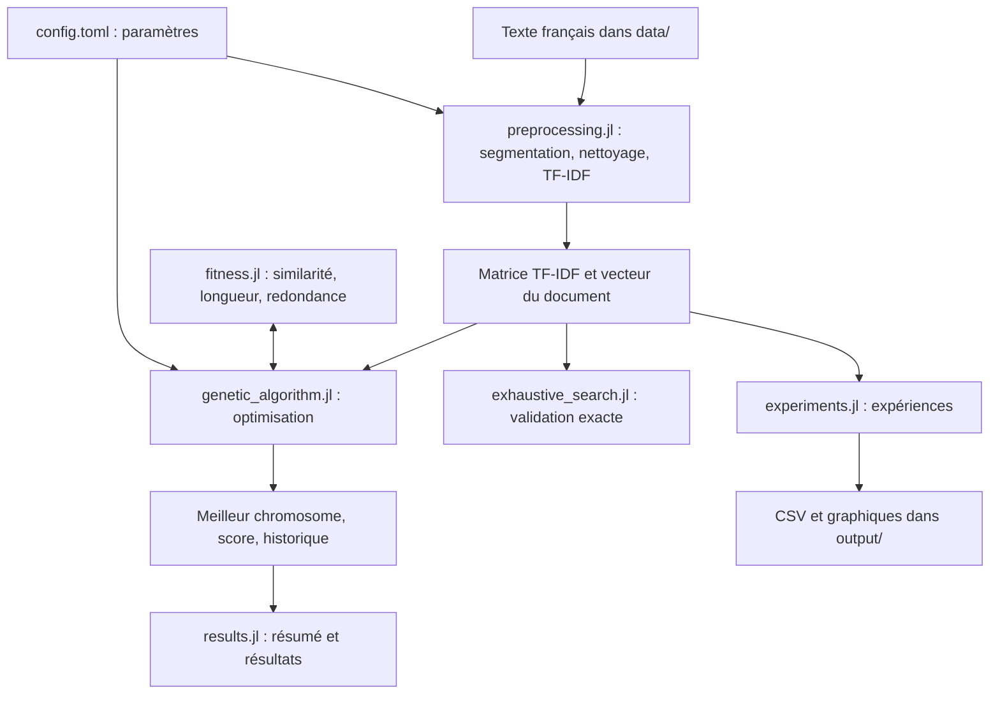
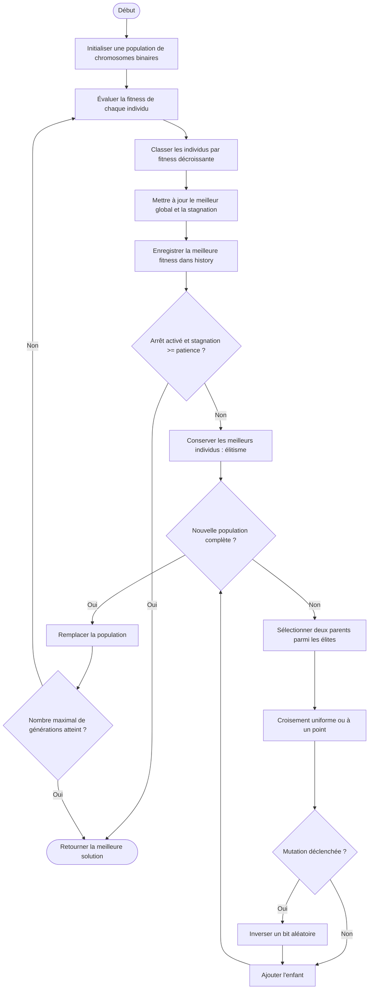

# Résumé automatique extractif par algorithme génétique

**Projet de métaheuristiques — Master Informatique, parcours ATAL — Nantes Université (2026–2027)**

## 1. Objectif

Le projet consiste à produire automatiquement un **résumé extractif** d'un document français : sélectionner un sous-ensemble de phrases du texte original, sans générer de nouvelles phrases.

Le problème est abordé comme une **optimisation combinatoire** à l'aide d'un **algorithme génétique (AG)** implémenté en **Julia**.

L'objectif est de rechercher un compromis entre :

- **Représentativité** : le résumé doit couvrir le contenu du document.
- **Concision** : le nombre de phrases retenues doit rester proche de la longueur cible.
- **Non-redondance** : éviter de sélectionner plusieurs phrases qui apportent essentiellement la même information.

## 2. Formulation du problème

Pour un texte de `n` phrases, une solution est représentée par un chromosome binaire :

`x = (x₁, x₂, …, xₙ)`

où `xᵢ = 1` si la phrase `i` est sélectionnée et `xᵢ = 0` sinon.

L'espace de recherche contient `2ⁿ` sous-ensembles possibles, y compris le résumé vide, considéré comme invalide par la fonction d'évaluation.

Cette croissance exponentielle motive l'utilisation d'une métaheuristique pour les textes longs.

### Fonction objectif

Les phrases et le document sont représentés par des vecteurs **TF-IDF**.

La qualité d'un chromosome est évaluée par :

```text
fitness(x) = α × similarité(x, document)
           − |k/n − γ|
           − β × redondance(x)
```

Avec :

- `k` : nombre de phrases sélectionnées ;
- `n` : nombre total de phrases ;
- `similarité` : similarité cosinus entre le vecteur moyen des phrases retenues et le vecteur du document ;
- `redondance` : moyenne des similarités cosinus entre les paires de phrases retenues ;
- `α` : poids de la représentativité ;
- `β` : poids de la pénalisation de redondance ;
- `γ` : proportion cible de phrases conservées.

Un résumé vide reçoit une fitness de `-Inf`.

**Important :** une fitness plus grande n'est directement comparable que si les coefficients de la fonction objectif et le prétraitement sont identiques.

Lorsqu'on modifie `α`, `β` ou `γ`, il faut également comparer les indicateurs indépendants : similarité, redondance et proportion de phrases conservées.

## 3. Prétraitement linguistique

Le prétraitement comprend les étapes suivantes :

1. Lecture du fichier texte UTF-8.
2. Segmentation en phrases.
3. Normalisation des termes : minuscules et suppression de la ponctuation.
4. Suppression facultative des mots vides (*stopwords*) français.
5. Construction de la représentation TF-IDF des phrases.
6. Construction du vecteur représentatif du document.

Le prétraitement est réalisé avec **TextAnalysis.jl** et les fonctions définies dans `src/preprocessing.jl`.

La segmentation utilise principalement la ponctuation de fin de phrase et les retours à la ligne.

Le vecteur global du document est calculé comme la moyenne des vecteurs TF-IDF de ses phrases.

## 4. Algorithme génétique

### 4.1. Représentation et population initiale

Chaque individu est un vecteur binaire de longueur `n`.

Une population de solutions candidates est créée aléatoirement, puis évaluée avec la fonction de fitness.

### 4.2. Sélection et élitisme

Les individus sont classés par fitness décroissante.

Les meilleurs sont conservés d'une génération à l'autre : c'est le principe de l'**élitisme**.

Dans cette implémentation, les parents sont également sélectionnés parmi les élites.

Le paramètre `elite_ratio` influence donc à la fois :

- le nombre d'individus conservés ;
- le groupe de parents disponibles pour la reproduction.

Le nombre d'élites est calculé par :

```text
E = min(pop_size, max(2, floor(elite_ratio × pop_size)))
```

### 4.3. Croisement

Deux opérateurs sont implémentés.

**Croisement à un point (`onepoint`)**

Un point de coupure est choisi aléatoirement. L'enfant reçoit la première partie du premier parent et la seconde partie du deuxième parent.

**Croisement uniforme (`uniform`)**

Pour chaque position du chromosome, le gène est choisi aléatoirement parmi les deux parents.

Ces deux opérateurs permettent de comparer différentes stratégies de recombinaison.

### 4.4. Mutation

Avec la probabilité `mutation_rate`, un bit choisi aléatoirement dans l'enfant est inversé :

- `0` devient `1` ;
- `1` devient `0`.

Il s'agit d'une mutation d'un seul bit par enfant lorsqu'elle est déclenchée, et non d'une mutation indépendante de chaque bit.

### 4.5. Critères d'arrêt

L'exécution est limitée par `generations`.

Un arrêt anticipé peut interrompre l'évolution lorsque la meilleure fitness ne s'améliore pas suffisamment pendant `patience` générations, selon le seuil `min_delta`.

Les paramètres sont définis dans la section `[convergence]` du fichier `config.toml`.

### 4.6. Architecture fonctionnelle

Le projet sépare le traitement linguistique, l'optimisation et l'analyse expérimentale.



### 4.7. Organigramme de l'algorithme génétique



**Remarque :** l'évaluation intervient au début de chaque génération et le test de stagnation avant la reproduction.

Le meilleur individu global est conservé indépendamment de la population courante.

### 4.8. Pseudo-code fidèle à l'implémentation

```text
Initialiser P chromosomes binaires aléatoires

best_score ← -∞
best_individual ← chromosome nul
history ← []
stagnation ← 0

E ← min(P, max(2, floor(elite_ratio × P)))

POUR generation = 1 à generations :

    Évaluer la fitness de tous les individus
    Classer les individus par fitness décroissante

    current_score ← meilleure fitness de la génération

    SI current_score > best_score :

        SI current_score > best_score + min_delta :
            stagnation ← 0
        SINON :
            stagnation ← stagnation + 1

        best_score ← current_score
        best_individual ← copie du meilleur individu

    SINON :
        stagnation ← stagnation + 1

    Ajouter best_score à history

    SI arrêt activé ET stagnation >= patience :
        ARRÊTER LA BOUCLE

    elites ← copies des E meilleurs individus
    nouvelle_population ← copie des élites

    TANT QUE taille(nouvelle_population) < P :

        p1, p2 ← parents sélectionnés parmi les élites

        enfant ← croisement(p1, p2)

        SI tirage aléatoire < mutation_rate :
            inverser un bit aléatoire de l'enfant

        Ajouter enfant à nouvelle_population

    population ← nouvelle_population

RETOURNER best_individual, best_score, history
```

### 4.9. Exemple d'une génération

Pour un texte de cinq phrases, le chromosome `10110` conserve les phrases 1, 3 et 4.

Avec `pop_size = 6` et `elite_ratio = 0.5`, les trois meilleurs chromosomes sont copiés sans modification.

Les trois places restantes sont remplies par des enfants issus de croisements entre élites, suivis éventuellement d'une mutation.

Les enfants seront évalués au début de la génération suivante.

### 4.10. Exploration, exploitation et convergence

- **Exploitation :** l'élitisme conserve les meilleurs chromosomes et les utilise comme parents.
- **Exploration :** le croisement recombine les gènes ; la mutation peut ajouter ou retirer une phrase.
- **Stagnation :** une amélioration strictement supérieure à `min_delta` remet le compteur à zéro. Une petite amélioration positive met à jour le meilleur score, mais augmente le compteur de stagnation.
- **Arrêt anticipé :** l'algorithme s'arrête lorsque le critère de stagnation est atteint, si cette option est activée.

L'arrêt anticipé ne garantit pas l'atteinte de l'optimum global.

## 5. Organisation du projet

```text
metaATAL/
├── config.toml
├── Project.toml
├── Manifest.toml
├── README.md
├── rapport_metaheuristiques_ATAL.zip
├── data/
│   ├── archives/
│   ├── input.txt
│   ├── texte1_HuggingFace.txt
│   ├── texte2_HuggingFace.txt
│   ├── texte3_HuggingFace.txt
│   └── texte4_HuggingFace.txt
├── src/
│   ├── preprocessing.jl
│   ├── fitness.jl
│   ├── genetic_algorithm.jl
│   ├── main.jl
│   ├── results.jl
│   ├── exhaustive_search.jl
│   ├── experiments.jl
│   ├── experiments_mutation.jl
│   ├── plot_experiments.jl
│   └── test_preprocessing.jl
└── output/
    ├── experiences_*.csv
    ├── convergence_*.png
    ├── resultats_*.txt
    └── figures/
        └── *.png
```

### Rôle des principaux fichiers

| Fichier | Responsabilité |
|---|---|
| `preprocessing.jl` | Chargement, segmentation, nettoyage et TF-IDF |
| `fitness.jl` | Calcul de la fonction objectif et des métriques |
| `genetic_algorithm.jl` | Initialisation, sélection, croisement, mutation, élitisme et convergence |
| `main.jl` | Exécution principale et affichage du résumé |
| `results.jl` | Sauvegarde du résumé et de la courbe de convergence |
| `exhaustive_search.jl` | Calcul de l'optimum exact pour les petits textes |
| `experiments.jl` | Campagnes expérimentales sur plusieurs documents |
| `experiments_mutation.jl` | Tests complémentaires du taux de mutation |
| `plot_experiments.jl` | Génération des graphiques comparatifs |
| `test_preprocessing.jl` | Vérification manuelle de la segmentation |

## 6. Installation

### Prérequis

- Julia installé et accessible depuis le terminal ;
- Git pour récupérer le dépôt.

### Cloner le projet

```bash
git clone https://github.com/miskaraminaa/metaATAL.git
cd metaATAL
```

Le dépôt est privé : son clonage nécessite une autorisation GitHub.

### Installer les dépendances

```bash
julia --project=. -e 'using Pkg; Pkg.instantiate()'
```

Les dépendances externes principales sont :

- `TextAnalysis.jl` ;
- `Plots.jl`.

Les modules standards de Julia utilisés comprennent notamment `Random`, `Statistics`, `LinearAlgebra`, `Dates` et `TOML`.

## 7. Configuration

Les paramètres sont centralisés dans `config.toml`.

La configuration actuellement versionnée est :

```toml
[nlp]
use_stopwords = true
input_file = "data/texte4_HuggingFace.txt"

[fitness]
alpha = 1.0
beta = 0.5
gamma = 0.3

[ga]
pop_size = 100
generations = 100
mutation_rate = 0.10
elite_ratio = 0.50
crossover = "uniform"

[convergence]
enabled = true
patience = 15
min_delta = 1.0e-6
```

Cette configuration constitue une référence d'exécution, et non une configuration optimale universelle.

Certaines campagnes expérimentales fixent explicitement des paramètres indépendamment de cette configuration.

## 8. Exécution

Depuis la racine du dépôt :

### Générer un résumé

```bash
julia --project=. src/main.jl
```

### Lancer les expériences actives

```bash
julia --project=. src/experiments.jl
```

### Vérifier la segmentation des textes

```bash
julia --project=. src/test_preprocessing.jl
```

### Générer les graphiques comparatifs

```bash
julia --project=. src/plot_experiments.jl
```

Pour changer de document, modifier `nlp.input_file` dans `config.toml`, puis relancer `src/main.jl`.

**Attention :** dans la version actuelle de `experiments.jl`, seule la campagne `use_stopwords` est activée. Les autres campagnes ont été utilisées précédemment et leurs configurations sont commentées dans le script.

Les résultats déjà produits sont disponibles dans `output/`.

## 9. Protocole expérimental

Les essais portent sur quatre documents français de tailles différentes.

| Document | Nombre de phrases |
|---|---:|
| Texte 1 | 14 |
| Texte 2 | 25 |
| Texte 3 | 38 |
| Texte 4 | 50 |

Chaque configuration est répétée avec cinq graines aléatoires :

```text
42, 123, 456, 789, 2026
```

Les indicateurs étudiés comprennent :

- fitness moyenne et écart-type ;
- temps moyen d'exécution ;
- nombre moyen de générations exécutées ;
- proportion de phrases conservées ;
- similarité TF-IDF du résumé avec le document ;
- redondance moyenne entre les phrases sélectionnées.

### Paramètres explorés

| Famille | Paramètre | Valeurs testées |
|---|---|---|
| Population | `pop_size` | 20, 50, 100, 200 |
| Mutation | `mutation_rate` | 0.01, 0.05, 0.10, 0.30 |
| Croisement | `crossover` | `onepoint`, `uniform` |
| Élitisme | `elite_ratio` | 0.25, 0.50, 0.75 |
| Convergence | `patience` | 5, 15, 30 |
| Convergence | `min_delta` | 1e-4, 1e-6, 1e-8 |
| Fitness | `alpha` | 0.5, 1.0, 2.0 |
| Fitness | `beta` | 0.0, 0.5, 1.0 |
| Fitness | `gamma` | 0.2, 0.3, 0.4 |
| NLP | `use_stopwords` | `true`, `false` |

Les paramètres non étudiés sont maintenus constants à l'intérieur de chaque campagne, afin d'isoler l'effet du paramètre testé.

Les résultats détaillés sont enregistrés dans les fichiers `output/experiences_*.csv`.

## 10. Résultats et interprétation

### 10.1. Taille de population

Une population plus grande améliore globalement la fitness moyenne, mais augmente le coût de calcul.

Une population de **100 individus** offre un compromis pratique, tandis que 200 individus peuvent être intéressants lorsque la qualité prime sur le temps de calcul.

### 10.2. Croisement

Le croisement **uniforme** obtient une fitness moyenne supérieure ou égale à celle du croisement à un point sur les quatre documents étudiés.

Ce résultat suggère que la recombinaison indépendante des gènes est adaptée à la représentation binaire utilisée.

### 10.3. Mutation

Aucun taux de mutation n'est systématiquement meilleur sur tous les documents.

La valeur `0.10` constitue une référence raisonnable, tandis que `0.05` reste compétitive dans plusieurs essais.

### 10.4. Élitisme

Augmenter `elite_ratio` n'améliore pas systématiquement la fitness.

Un ratio plus élevé peut également accroître le nombre de générations exécutées.

La valeur `0.50` représente un compromis dans les expériences réalisées.

### 10.5. Arrêt anticipé

Une patience plus élevée augmente généralement le nombre de générations, sans amélioration proportionnelle de la fitness.

Une patience de 15 générations permet de limiter les calculs inutiles dans la configuration étudiée.

Une comparaison spécifique entre `convergence.enabled = true` et `false` reste à réaliser.

### 10.6. Paramètres de la fonction fitness

**Influence de `alpha`**

Augmenter le poids de la représentativité peut conduire à retenir davantage de phrases.

**Influence de `beta`**

Une pénalisation plus forte de la redondance réduit globalement les répétitions, parfois au prix d'une légère baisse de similarité.

**Influence de `gamma`**

Augmenter la proportion cible conduit généralement à des résumés plus longs.

Les valeurs brutes de fitness ne doivent pas être directement comparées lorsque les coefficients de la fonction objectif changent.

### 10.7. Suppression des stopwords

L'activation de la suppression des stopwords réduit la redondance mesurée dans les expériences.

La désactivation peut augmenter la similarité TF-IDF.

Cependant, le prétraitement modifie l'espace vectoriel : ces comparaisons doivent donc être interprétées avec prudence.

### 10.8. Validation par recherche exhaustive

Pour le **texte 1 contenant 14 phrases**, une recherche exhaustive permet de calculer l'optimum exact.

Une exécution de l'algorithme génétique a retrouvé une fitness d'environ :

```text
Fitness AG       : 0.668011
Fitness optimale : 0.668011
Écart            : 0
```

Ce résultat confirme que l'algorithme génétique peut retrouver l'optimum sur ce petit exemple.

Il ne garantit toutefois pas l'optimalité pour les textes plus longs.

## 11. Évaluation qualitative des résumés

La fitness ne mesure pas directement la fluidité de lecture ou la cohérence discursive.

Une inspection qualitative a été réalisée sur une sortie du texte 3 et une sortie du texte 4.

| Critère | Texte 3 : rivalité sino-américaine | Texte 4 : PMA et accès aux origines |
|---|---|---|
| Phrases retenues | 12 sur 38 (31,6 %) | 15 sur 50 (30 %) |
| Pertinence | Plusieurs dimensions de la rivalité sont couvertes | Le droit aux origines et les droits des enfants sont présents |
| Cohérence | Une ouverture avec « Mais elle » manque d'antécédent | Certaines phrases isolées manquent de contexte |
| Redondance | Répétitions thématiques limitées | Quelques recoupements sur les droits et l'accès aux origines |

Cette lecture est illustrative et ne constitue pas une évaluation humaine normalisée.

L'ordre original des phrases est conservé, mais cela ne garantit pas des transitions naturelles entre les phrases sélectionnées.

## 12. Limites

Le système présente plusieurs limites.

- **Représentation lexicale :** TF-IDF mesure surtout la proximité des mots et ne capture pas toutes les relations sémantiques.
- **Cohérence :** la sélection de phrases originales ne garantit pas la fluidité du résumé.
- **Fonction objectif :** les coefficients déterminent un compromis entre plusieurs critères, sans remplacer une évaluation humaine.
- **Stochasticité :** les résultats peuvent dépendre de la graine aléatoire et du document.
- **Temps de calcul :** les mesures Julia peuvent être influencées par la compilation initiale.
- **Validation exacte :** la recherche exhaustive est limitée aux petits textes en raison de sa complexité exponentielle.

## 13. Perspectives

Plusieurs améliorations sont envisageables :

1. Évaluer les résumés avec des références humaines et des métriques adaptées.
2. Comparer TF-IDF à des représentations sémantiques comme les embeddings.
3. Comparer l'algorithme génétique à une méthode gloutonne ou à d'autres métaheuristiques.
4. Tester des documents plus longs et issus de différents domaines.
5. Étudier une optimisation multiobjectif séparant représentativité, longueur et redondance.
6. Améliorer la cohérence discursive des phrases sélectionnées.

## 14. Limites méthodologiques et reproductibilité

### Comparabilité des résultats

Lorsque `alpha`, `beta` ou `gamma` changent, il convient de comparer les composantes de la fonction objectif plutôt que les scores bruts de fitness.

Les métriques calculées avec et sans suppression des stopwords reposent également sur des espaces TF-IDF différents.

### Mesure des temps d'exécution

Les premières exécutions Julia peuvent inclure la compilation.

Un échauffement (*warm-up*) ou un outil de benchmark spécialisé permettrait de mesurer les performances de manière plus rigoureuse.

### Validation exacte

La recherche exhaustive sur 14 phrases ne permet pas de conclure à l'optimalité sur les textes de 25, 38 et 50 phrases.

### Arrêt anticipé

L'effet de `patience` et de `min_delta` a été étudié.

Une comparaison spécifique entre l'arrêt anticipé activé et désactivé reste à effectuer.

### Fichiers de sortie

Les fichiers CSV et les figures présents dans `output/` proviennent de différentes campagnes expérimentales.

Dans la version actuelle, certains CSV contiennent dix valeurs par ligne alors que leur en-tête n'en déclare que sept. Cette incohérence doit être corrigée dans `experiments.jl`.

Le script `plot_experiments.jl` prend déjà en charge les dix valeurs pour les fichiers concernés.

### Reproductibilité

Le dépôt contient :

- les fichiers de configuration ;
- les dépendances Julia ;
- les quatre textes expérimentaux ;
- les graines aléatoires ;
- les scripts de traitement et d'optimisation ;
- les résultats CSV et les figures.

Ces éléments facilitent la reproduction des expériences.

---

**Projet de métaheuristiques — Résumé automatique extractif par algorithme génétique — Master 1 ATAL, Nantes Université.**
